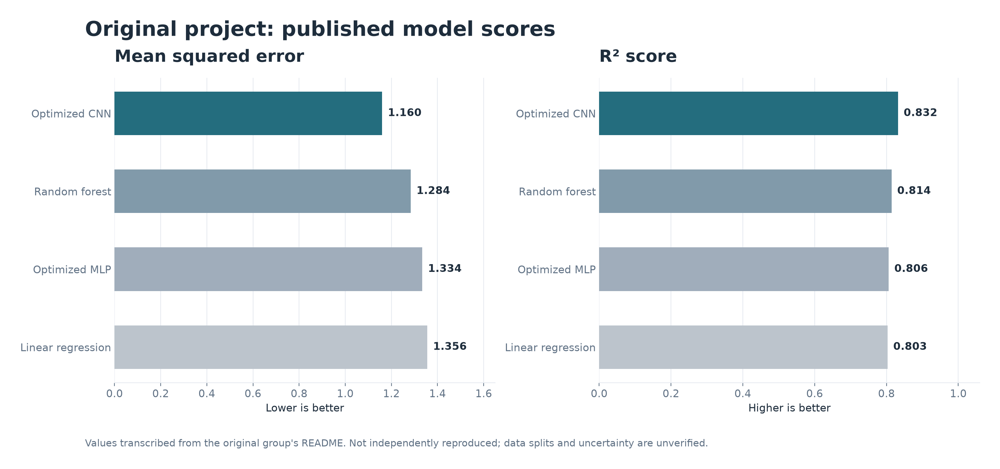
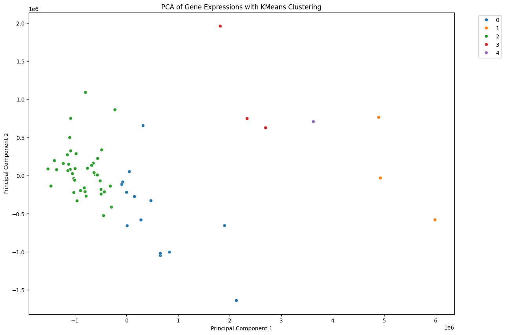
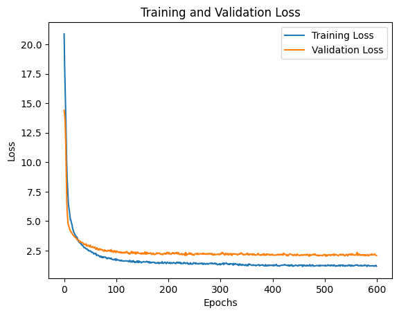
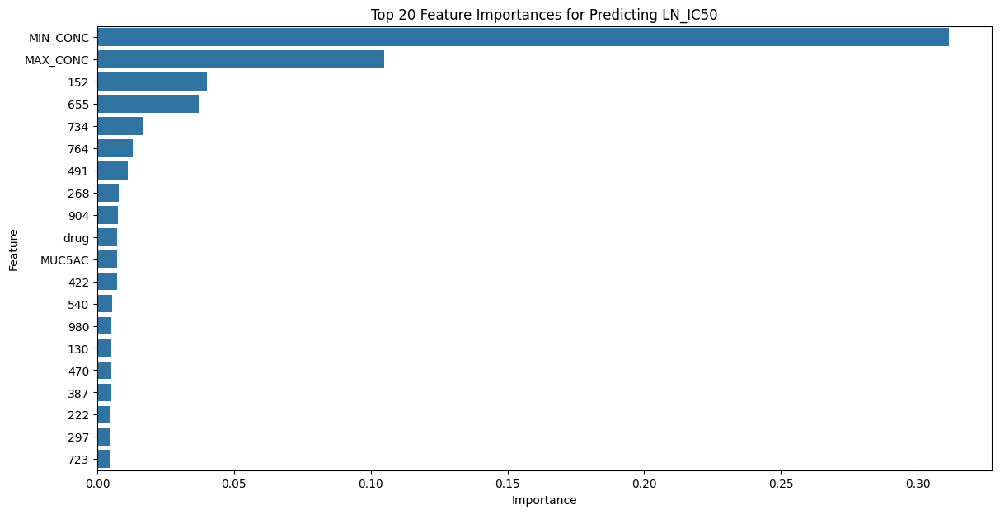
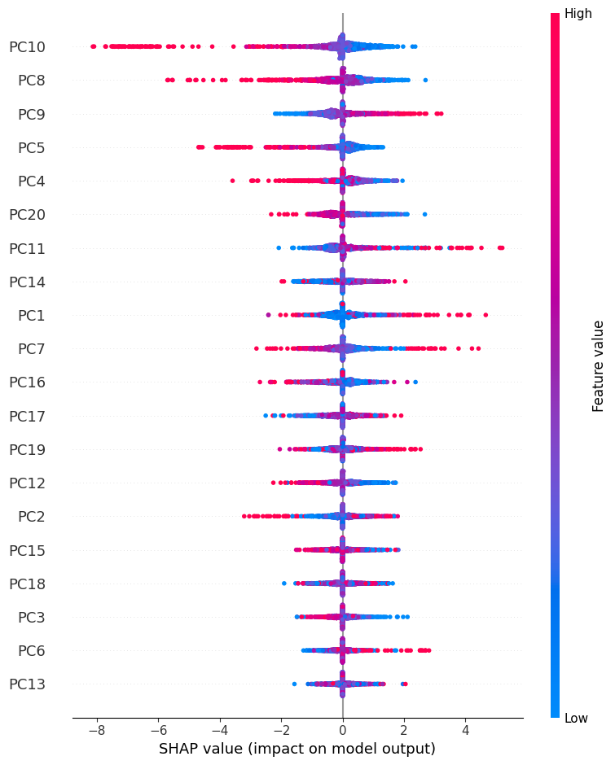

# Cancer Drug Response Prediction

**Gene expression × molecular fingerprints → drug-sensitivity modelling**

A reproducibility-focused modernization of the collaborative cancer drug
response prediction project, integrating gene expression and drug features
to predict **LN_IC50** on cancer cell-line/drug experiments.

[Original group project](https://github.com/davidenoma/DL_cancer_drug_response) ·
[Study architecture](docs/architecture.md) ·
[Data contract](data/README.md) ·
[Reproduction checklist](docs/reproduction.md) ·
[Contributions and attribution](docs/attribution.md)

> **Research project, not a clinical diagnostic model.** The original datasets
> and split artifacts were not published in the source repository. Historic
> model metrics below are **reported by the team, not independently reproduced**.

## Original project results (reported; not reproduced)

| Model | MSE ↓ | R² ↑ | MAE ↓ |
|:--|--:|--:|--:|
| **Optimized CNN** | **1.160** | **0.832** | **0.810** |
| Random forest | 1.284 | 0.814 | — |
| Optimized MLP | 1.334 | 0.806 | — |
| Linear regression | 1.356 | 0.803 | — |

*Source: [original team's README](https://github.com/davidenoma/DL_cancer_drug_response/blob/main/README.md).
Numbers are historical claims, not results of this modernized pipeline.
Evaluation splits and sample identifiers have not been recovered.*



## Original study figure archive

The original team also published PCA/clustering, training-history,
feature-importance and SHAP illustrations. They are archived unchanged and
are **not independently regenerated from the missing original data**.

<details>
<summary>View four historical figures (original group, unverified)</summary>

| Gene-expression exploration | Training-history illustration |
|:---:|:---:|
|  |  |

| Original feature importance | Original SHAP summary |
|:---:|:---:|
|  |  |

</details>

## What is reproducible today

The modernization replaces fixed Colab/Kaggle paths and notebook globals with
a standalone, installable Python package. Without real licensed datasets, it
runs an **explicitly synthetic** end-to-end exercise to verify engineering
behavior, not biological accuracy.

- **Validated inputs:** response, expression, and drug fingerprint CSVs
  joined by unique IDs, with rejected ambiguous model/drug pairs.
- **SMILES:** optional RDKit Morgan-fingerprint encoding.
- **Leakage-aware splits:** withheld cell lines (default) or withheld drugs.
  Grouped cross-validation and all preprocessing happen inside training.
- **Models:** reproducible Ridge, Random Forest, and MLP baselines with
  group-aware hyperparameter selection.
- **Auditable output:** saved test predictions, MSE/MAE/R², selected parameters,
  split provenance and high-resolution PNG/SVG figures.
- **Tests and CI:** fast synthetic smoke run and contract tests; no cloud
  credentials or patient data required.

These modernized baselines are **not** representations of the historical
optimized CNN experiment.

## Quick start

Requires **Python 3.11+**.

```bash
python -m pip install -e ".[dev]"
pytest
drug-response demo --output runs/demo
drug-response plot-reported
```

Open the synthetic demonstration figures in `runs/demo/`.
The figure in this README is built from the **historical reported scores**
and is explicitly labeled that way. No prediction scatterplot is invented
for the historical CNN because its underlying predictions are unavailable.

### Use with real data (when obtained legally)

```bash
# Supply local data/response.csv, data/genes.csv and data/fingerprints.csv.
drug-response prepare --response data/response.csv --genes data/genes.csv \
    --fingerprints data/fingerprints.csv --output data/prepared.csv

# Group-disjoint test by cell line (not by individual response row).
drug-response fit --input data/prepared.csv --group-by model_id --output runs/real

# Alternate experiment: unseen drugs.
drug-response fit --input data/prepared.csv --group-by drug_id --output runs/unseen-drugs
```

Instructions for preparing inputs and configuring optional RDKit encoding
are in [the data contract](data/README.md).

## Repository layout

```text
src/drug_response/        maintained training, feature & plotting code
scripts/                  reproducibility helpers
config/                   historical reported benchmark values
tests/                    synthetic/data-validation regression tests
docs/                     architecture, credits, reproducibility
legacy/                   historical team scripts (read-only reference)
reports/figures/          generated visualizations from attributed metrics
data/                     untracked research datasets (contract only)
```

The 11 MB historical notebook remains in the
[original repository](https://github.com/davidenoma/DL_cancer_drug_response/blob/main/dl_cancer_drug_response.ipynb).
The original team had already exported sections to independent-looking
scripts, but those scripts still contain cross-section globals and
non-portable paths. We preserve them in `legacy/` as primary-source
references; the new `src/drug_response/` package is the runnable replacement.

## Collaborators

Original academic team: **David Enoma, Sasha Chernenkoff,
Ariel Ghislain Kemogne Kamdoum, and Mojtaba Kanani Sarcheshmeh**.
See [contribution notes](docs/attribution.md) for section-level provenance.

**Scope and limitations:** Predictions are for experimental cancer cell-line
drug response, not an individual's treatment outcome. No clinical validation,
causal interpretation, or patient-specific recommendation is asserted. Exact
reproduction of the team CNN requires the missing original datasets and
experimental metadata.

The original repository is licensed under **Apache-2.0**.
