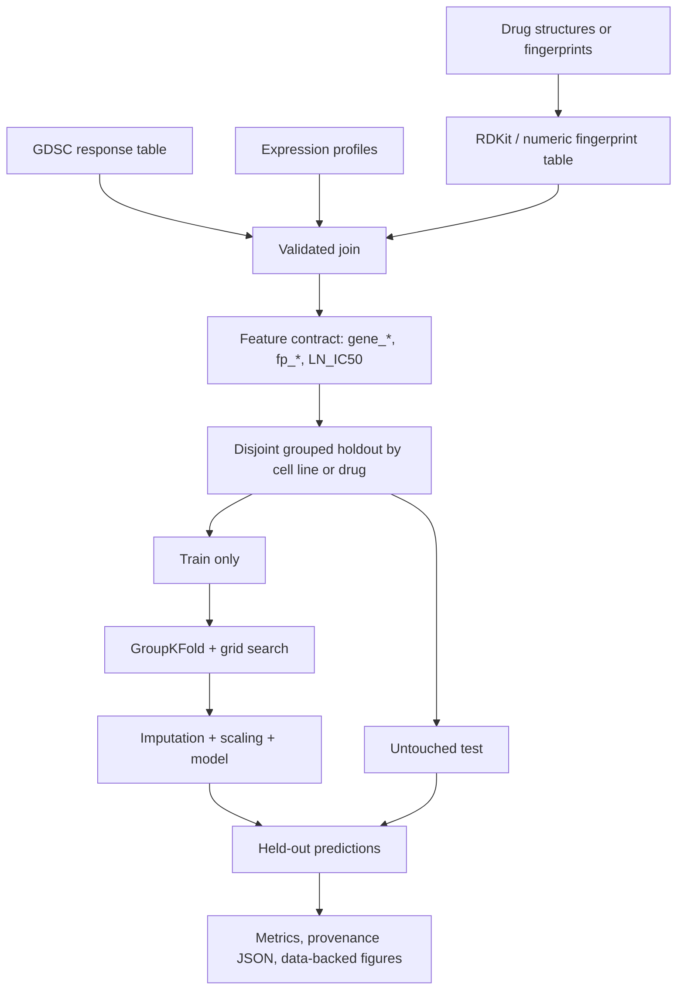

# Architecture and reproduction layers

## Two independent result streams

1. **Historical team findings** from the source README are stored in
   `config/original_reported_results.json` and visualized explicitly as
   *reported, not reproduced*. They are not re-labelled as modern validation.
2. **Modern evaluations** are generated only by executable code on input data.
   The `demo` command uses a fictional dataset, labels its outputs synthetic,
   and exists solely to check installation, packaging and model-training logic.

## Modularity

- `data.py`: input validation and strict joining of expression/response/drug.
- `chemistry.py`: optional RDKit Morgan fingerprints from molecular SMILES.
- `validation.py`: group-disjoint test and group-disjoint training CV.
- `training.py`: fixed-seed Ridge/forest/MLP baselines with training-only tuning.
- `plotting.py`: reproducible visualizations based on computed predictions or
  explicitly transcribed historical metrics.
- `cli.py`: stable entry point for preparing, fitting, plotting and smoke tests.

The original notebook-derived sections are preserved under `legacy/`
for historical inspection, **not** imported into the working package. The
source notebook is over 11 MB and stays accessible at the source link rather
than bloating this public repository's history.

## Model research follow-up

The production research code explored convolutional gene feature encoders,
sequence encoders for SMILES, autoencoder/PCA feature reduction, SHAP analysis,
and Keras Tuner searches. Reproducing these legitimately requires access to
the original large dataset and exact preprocessing. A smaller verified
group-aware baseline is provided first, rather than claiming a CNN trained
successfully on synthetic data.
